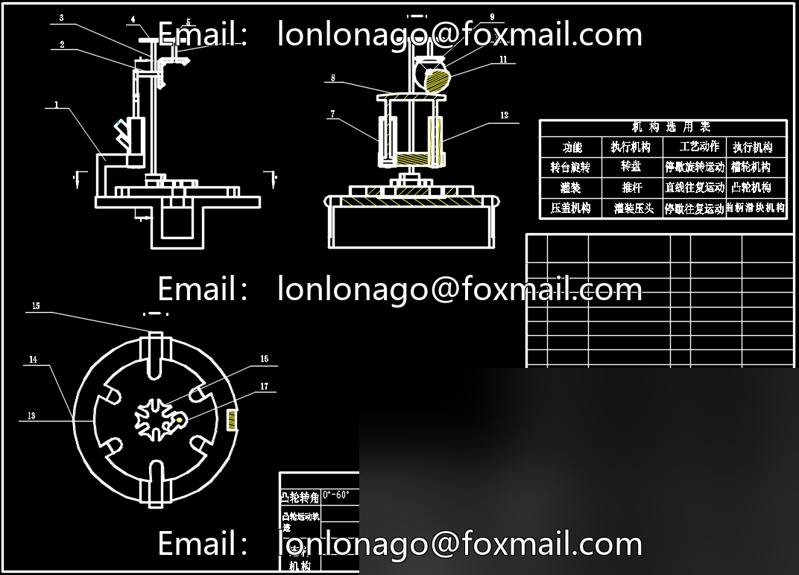
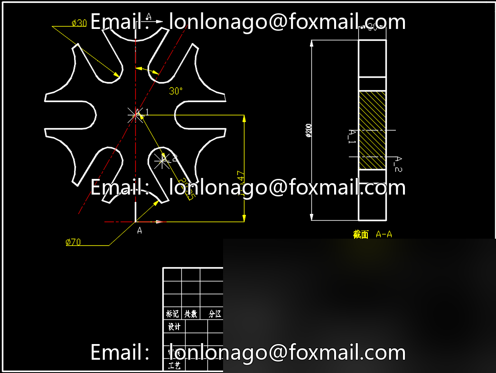
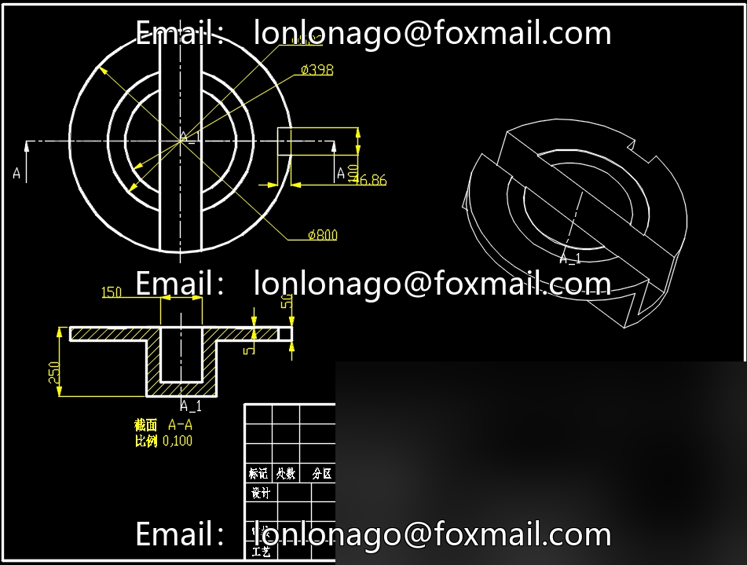
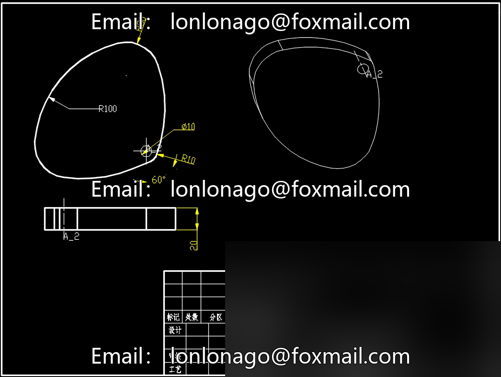
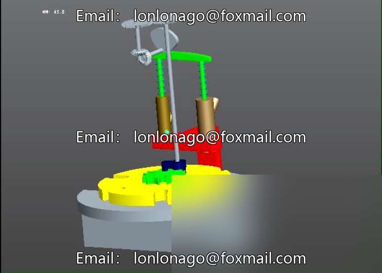
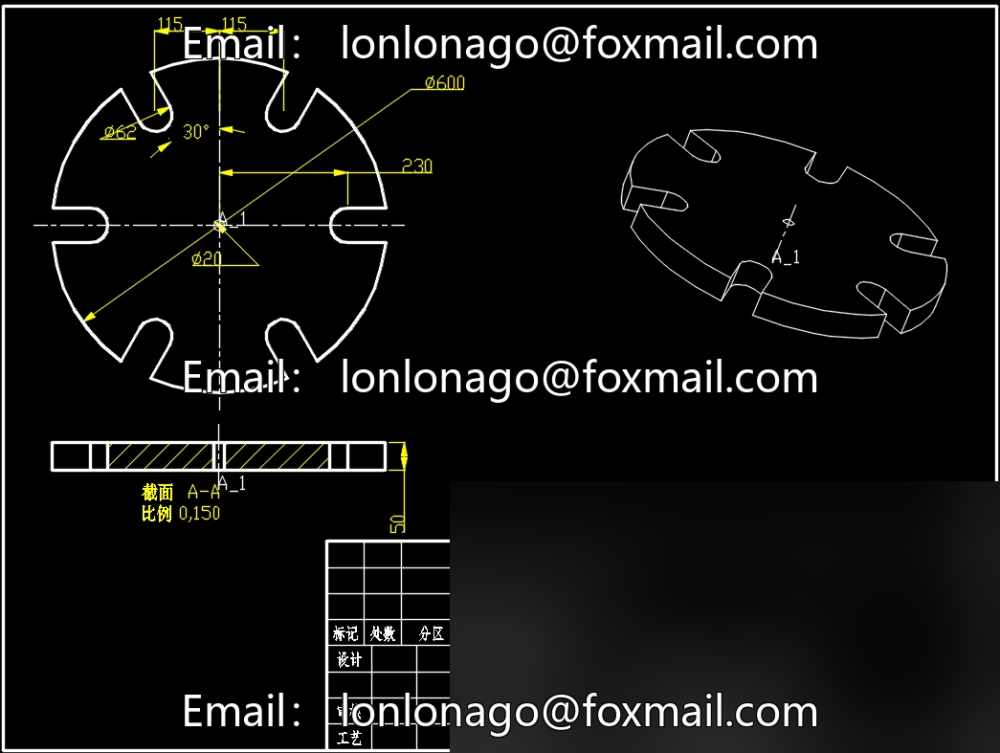
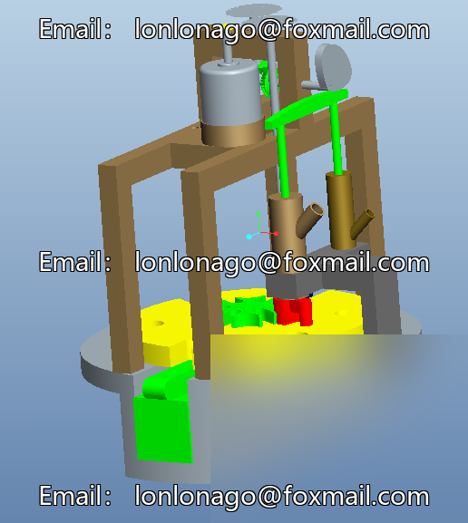

# Rotary filling machine design, rotary filling machine design drawing, rotary filling machine design three-dimensional diagram

## Body

The rotation-type feed machine design, rotation-type feed machine design diagram, rotation-type feed machine design three-dimensional diagram, rotation-type feed machine design CAD diagram, rotation-type feed machine design two-dimensional diagram
558

The design covers a rotary filling machine, 3D, CAD and 2D diagrams, including an organization table, execution mechanism, process action, tabletop rotation, stop rotation motion, slot gear mechanism, linear reciprocating motion, force cam mechanism, press cover mechanism, filling pressure head, stop reciprocating motion crank-slider mechanism, and documentation, model and corresponding drawings.

<!-- AI_ENRICHED -->

## Images

## Payment

Here is a pay link on Stripe ( https://buy.stripe.com/3cs8yP7sY87d0vu9AB ). Please contact me lonlonago@foxmail.com after funding $89, and I will send you a complete data files , thank you!

